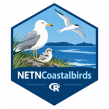

# NETNCoastalBirds




An R package for importing, summarizing, visualizing, and analyzing data from the **National Park Service Northeast Temperate Network (NETN) Coastal Breeding Bird Monitoring Program**. This program collects monitoring data following survey procedures detailed in [Trocki et al. 2015](https://irma.nps.gov/DataStore/Reference/Profile/2221844) 

The package provides tools for working with monitoring data collected through a combination of boat- and ground-based nest counts. Functions are provided for importing raw monitoring data, producing standardized summaries of nests by islands, and generating time-series plots for analysis.

[NETN Coastal Birds Monitoring Program](https://www.nps.gov/im/netn/coastal-birds.htm)

---

## Overview

`NETNCoastalBirds` was developed to support reproducible analysis and reporting of data from the NETN Coastal Breeding Bird Monitoring Program.

The current version (0.1.5) includes workflows for importing and summarizing:

* Annual boat-based monitoring of Common Eider, Double-crested Cormorant, and gulls
* Periodic (3-5 years) ground-based nest counts of Common Eider, Double-crested Cormorant, gulls, wading bird species.

Future development will incorporate American Oystercatcher and terns.

The package provides a workflow for:

* importing monitoring data from the NETN Coastal Bird Access database or exported database tables;
* retrieving survey-effort information;
* summarizing observations by date, year, island, segment, species, and life stage;
* calculating effort-adjusted observations;
* examining survey history and sampling effort;
* producing data tables suitable for reporting; and
* generating standardized plots of coastal bird monitoring data.

---

## Installation

The development version can be installed from GitHub using `remotes`:

```r
# Install pak if necessary
install.packages("pak")

# Install NETNCoastalBirds
library(pak)
pak::pkg_install("aaronweed/NETNCoastalBirds")
```

Load the package:

```r
library(NETNCoastalBirds)
```

---

# Data workflow

There are two primary ways to work with the monitoring data.

### Option 1: Retrieve data from the network's database

Users with access to the NETN Coastal Bird Access database can retrieve current data using the Windows ODBC connection named `NETNCB`.

For example:

```r
nest_data <- GetNestData()

incubation_data <- GetIncubationData()

creche_data <- GetCrecheData()

amoy_data <- GetAMOYData()
```

The data-retrieval functions use the underlying Access database to construct standardized data frames for subsequent analysis.

---

### Option 2: Importing data package

The data package contains tables exported from the NETN Coastal Bird database that is published annually at this URL [DS link].

`importCBBData()` imports the exported database views and stores them in the `CBB_TABLES` environment by default.

For example:

A ZIP archive containing the exported tables can be imported:

```r
importCBBData(
  path = "C:/Coastal_Birds/exports/NETN",
  zip_name = "CBB_Dataset_Export_20230119.zip"
)
```

The imported database views include:

* Survey events and survey effort
* Incubation Surveys: counts of cormorants and gulls
* Ground-based Nest Surveys: counts of multiple species
* Creche Surveys: counts of Common Eider life stages (females and ducklings)
* American Oystercatcher surveys*
* American Oystercatcher/Piping Plover summaries*
* Tern summaries*
* Surveillance surveys*
* Incidental observations*

*Functions for these surveys are still in development

---

# Survey Effort

Many monitoring summaries can be expressed as effort-adjusted observations. 

`importCBBData()` creates a data frame object `seg_event` from the data package for retrieving survey effort by species, island, segment, and survey type.

For example, 

```r

cbb<- importCBBData(
  path = "C:/Coastal_Birds/exports/NETN",
  zip_name = "CBB_Dataset_Export_20230119.zip"
)

cbb$seg_event

```

---

# Summarizing monitoring data

## Ground-based Nest surveys

`SumNestSurveys()` summarizes ground-based nest surveys by date or year and can return raw and effort-adjusted counts.

For example:

Summarize survey results per island each year for Common Eider

```r
nest_summary <- SumNestSurveys(cbb$nest_surveys_raw,
  time = "year",
  species = "COEI",
  survey_effort= cbb$seg_event,
  output = "graph"
)
```

The function can summarize:

* Number of nests;
* Number of chicks; and
* Number of eggs.

---

## Boat-based Incubation surveys

`SumIncubation()` summarizes boat-based incubation surveys for double-crested Cormorants and gulls.

For example:

Summarize the annual number of incubating adults counted on each island per year

```r
incubation_summary <- SumIncubation(cbb$incubation_raw,
  time = "year",
  species = "DCCO",
  survey_effort= cbb$seg_event,
  output = "graph"
)
```

Annual summaries account for repeated surveys, including the use of the maximum nest count for species and sites where multiple surveys occur within a year.

Annual summaries can include statistics such as:

* sum;
* mean;
* maximum; and
* minimum.

The function can also return observations summarized by observer for date-level analyses.

---

## Boat-based Common Eider creche surveys

`SumCreche()` summarizes Common Eider (`COEI`) creche surveys which include counts of ducklings, all females, and only females observed tending ducklings. 

```r
creche_summary <- SumCreche(cbb$creche_raw,
  time = "year",
  survey_effort= cbb$seg_event,
  output = "graph"
)
```

The resulting summaries include measures such as:

* Number of adult females tending ducklings;
* Number of ducklings; and
* Number of total female Common Eiders observed.

For observer-level daily summaries per island:

```r
creche_observer <- SumCreche(cbb$creche_raw,
  time = "date",
  survey_effort= cbb$seg_event,
  ByObserver = "yes"
)
```

---

# Visualizing monitoring data

`PlotBirds()` provides a common plotting interface for summarized monitoring data at the daily or annual periods or island or all islands scales.

The function can be used with output from:

* `SumNestSurveys()`
* `SumIncubation()`
* `SumCreche()`

It supports:

* raw or effort-adjusted counts;
* filtering by island;
* filtering by species;
* selecting a life-stage or other variable;
* annual statistics (max, mean);
* log-scaled counts;
* faceting by island, species, or variable; and
* overlaying species, life stages, or islands.

For example:

```r
nest_summary<-SumNestSurvey(df = cbb$nest_surveys_raw, time = "year")

PlotBirds(
  nest_summary,
  species = "COEI",
  stat ="max",
  var = "Nests"
)
```

---

# Typical analysis workflow

A typical workflow using the package is:

### 1. Load the package

```r
library(NETNCoastalBirds)
```

### 2. Import the monitoring data

Either use the bundled data:

```r
cbb<-importCBBData(
  path = "C:/Coastal_Birds/exports/NETN",
  zip_name = "CBB_Dataset_Export_20230119.zip"
)
```

or retrieve current data from the database:

```r
nest_data <- GetNestData()
```

### 3. Summarize the observations

For example, for each year:

```r
nest_summary <- SumNestSurveys(cbb$nest_surveys_raw,
  df = nest_data,
  time = "year",
  species = "COEI",
  output = "graph"
)
```

### 4. Visualize the results

```r
PlotBirds(
  nest_summary,
  species = "COEI",
  var = "Nests"
)
```

The same general workflow can be used for incubation and creche monitoring:

```r
incubation <- GetIncubationData()

incubation_summary <- SumIncubation(cbb$incubation_raw,
  df = incubation,
  time = "year",
  species = "DCCO",
  output = "graph"
)

PlotBirds(
  incubation_summary,
  species = "DCCO"
)
```

---

# Function reference

The primary exported functions are:

### Data access

* `GetCrecheData()`
* `GetIncubationData()`
* `GetNestData()`
* `GetSurveyData()`
* `importCBBData()`

### Summaries

* `SumCreche()`
* `SumIncubation()`
* `SumNestSurveys()`

### Visualization and survey history

* `PlotBirds()`

---

# Data provenance

The monitoring data used by this package originate from the **NETN Coastal Breeding Bird Monitoring Program** and its associated database and monitoring protocols.

Because the underlying monitoring database is periodically updated, users conducting analyses intended to represent the most current monitoring information should retrieve current data at the following link [DS link of published data].

---

# Monitoring program and protocol

Additional information about the NETN Coastal Breeding Bird Monitoring Program, including monitoring protocols and program documentation, is available from the National Park Service:

[NETN Coastal Birds](https://www.nps.gov/im/netn/coastal-birds.htm)

The monitoring protocol:

> Trocki, C. L., B. R. Mitchell, and P. W. C. Paton. 2015. *Coastal breeding bird monitoring protocol for Boston Harbor Islands National Recreation Area: 2015 revision.* Natural Resource Report NPS/NETN/NRR—2015/954. National Park Service, Fort Collins, Colorado.

---

# Development status

`NETNCoastalBirds` is under active development.

The current development version is **0.1.5**.

The package is being updated to improve:

* consistency among data-import functions;
* documentation;
* data-processing workflows;
* summary functions;
* visualization;
* testing; and
* reproducibility of monitoring reports.

Please report problems or suggestions using the [GitHub Issues](https://github.com/aaronweed/NETNCoastalBirds/issues) page.

---

# License

The current package metadata specifies **No license**. A formal open-source license should be added if the package is intended for broader redistribution or reuse.

---

# Contact

For questions about `NETNCoastalBirds`, please open an issue in the GitHub repository.

For information about the NETN Coastal Breeding Bird Monitoring Program, visit the [National Park Service NETN Coastal Birds](https://www.nps.gov/im/netn/coastal-birds.htm) webpage.
